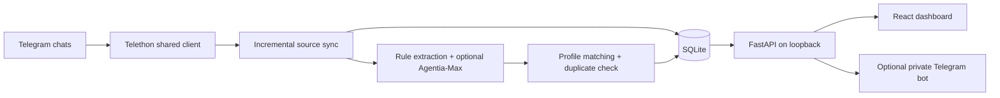

# Architecture

The backend is a single process. It shares one Telethon client, serializing connection setup while allowing source-list requests during history processing. A newly enabled source starts at midnight on the same date in the previous calendar month; later syncs continue from the saved message ID. Startup removes older jobs and message records while preserving source settings. The monitor catches up 10 messages per source per pass, resuming every second while a backlog remains; manual sync is capped at 20 messages per request; once caught up, it checks enabled chats every five minutes. Opening or returning to the dashboard wakes the monitor immediately. SQLite stores profiles, resume versions, source checkpoints, messages, jobs, and applications by default; PostgreSQL can be configured for deployments. Original resumes live under `storage/resumes/`, which is private and Git-ignored. The database, resume folder, and Telegram session must use durable storage and be backed up together.

Inference only receives Telegram job text. Resume text is parsed locally and is not sent to the model. If the configured model is unavailable, deterministic extraction and matching remain active.

Vercel may serve the static dashboard, but its request-scoped functions and temporary filesystem cannot host the long-running Telegram monitor or durable Telethon session. A Vercel deployment therefore needs an external persistent API/worker and database; see `docs/DEPLOYMENT.md`.
